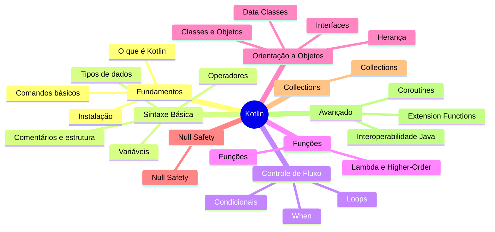

---
tags:
  - kotlin
  - moc
  - mapa-mental
---

# Kotlin — Mapa Mental

Hub central do estudo. Cada tema está em um arquivo separado; use os links `[[ ]]` para navegar no Obsidian.



## 01 — Fundamentos

- [[O que é Kotlin]]
- [[Instalação]]
- [[Comandos básicos]]

## 02 — Sintaxe Básica

- [[Variáveis]]
- [[Tipos de dados]]
- [[Operadores]]
- [[Comentários e estrutura]]

## 03 — Controle de Fluxo

- [[Condicionais]]
- [[When]]
- [[Loops]]

## 04 — Funções

- [[Funções]]
- [[Lambda e Higher-Order]]

## 05 — Orientação a Objetos

- [[Classes e Objetos]]
- [[Herança]]
- [[Interfaces]]
- [[Data Classes]]

## 06 — Null Safety

- [[Null Safety]]

## 07 — Collections

- [[Collections]]

## 08 — Avançado

- [[Extension Functions]]
- [[Coroutines]]
- [[Interoperabilidade Java]]

## Como usar no Obsidian

1. Abra esta pasta como **vault** no Obsidian (`Abrir pasta como cofre`).
2. Ative o plugin **Graph View** para ver as conexões entre notas.
3. O diagrama Mermaid acima aparece no preview (ou com o plugin Mermaid).
4. Estude na ordem numérica das pastas, ou pule pelos links conforme a necessidade.

## Ordem sugerida de estudo

```
Fundamentos → Sintaxe → Controle de Fluxo → Funções → OOP → Null Safety → Collections → Avançado
```
